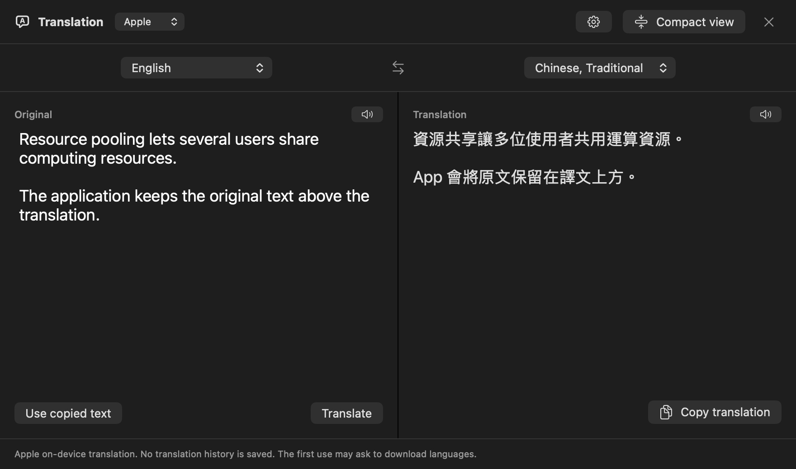
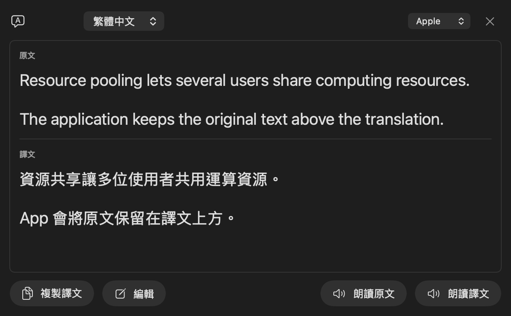

<p align="center">
  <picture>
    <source media="(prefers-color-scheme: dark)" srcset="docs/assets/readme/logo-dark.svg">
    
  </picture>
</p>

<h1 align="center">PlainTranslate</h1>

<p align="center">
  Mac のためのネイティブ翻訳アプリ。<br>
  Apple のオンデバイス翻訳、または自分の Google Cloud キーで。
</p>

<p align="center">
  <a href="README.md">English</a> ·
  <a href="README.md#繁體中文快速開始">繁體中文</a> ·
  <a href="README.zh-CN.md">简体中文</a> ·
  <strong>日本語</strong>
</p>

<p align="center">
  <a href="#インストール">インストール</a> ·
  <a href="#機能">機能</a> ·
  <a href="#使い始める">設定ガイド</a> ·
  <a href="#プライバシーを標準で保護">プライバシー</a> ·
  <a href="#自分でビルドする">ビルド</a> ·
  <a href="https://github.com/ChyoChan/PlainTranslate/issues">問題を報告</a>
</p>

<p align="center">
  <a href="https://github.com/ChyoChan/PlainTranslate/releases"></a>
  <a href="https://github.com/ChyoChan/PlainTranslate/releases"></a>
  <a href="https://github.com/ChyoChan/PlainTranslate/actions/workflows/ci.yml"></a>
  <a href="#動作環境"></a>
  <a href="LICENSE"></a>
</p>

<p align="center">
  
  
</p>

テキストを入力・貼り付けするか、ほかのアプリで選択してください。原文と訳文を並べた編集画面やコンパクトなポップアップで、翻訳の確認、読み上げ、コピーができます。PlainTranslate は無料のオープンソースアプリです。アプリのアカウント、テレメトリ、共有 API キーはありません。Google Cloud を使う場合のリクエストは、ご自身のプロジェクトに課金されます。

**プレビュー版について：** この README は開発版を説明しています。公開済みのプレビュー版には一部の機能が含まれていない場合があります。ダウンロードするバージョンの[リリースノート](https://github.com/ChyoChan/PlainTranslate/releases)をご確認ください。

## 翻訳エンジンを選ぶ

| エンジン | 必要なもの | 翻訳の実行場所 |
| --- | --- | --- |
| **Apple** — デフォルト | 画面の案内に従って言語パックをダウンロード。API キーは不要。 | Apple の Translation フレームワークを使い、Mac 上で処理。 |
| **Google Cloud** — 任意 | ご自身の Cloud Translation API キー、API の有効化、課金設定。 | テキストを Google Cloud Translation Basic v2 に直接送信。料金が発生する場合あり。 |

翻訳ウインドウ、または「設定 → 翻訳」で選べます。選択内容は保存されます。Apple 翻訳を利用できなくても、自動的に Google に切り替わることはありません。

## 機能

### 翻訳と編集

- **2 つの表示。** 原文と訳文を左右に並べて編集するか、原文の下に訳文を表示するコンパクトなポップアップを使えます。
- **自動翻訳。** 入力や貼り付けから約 0.6 秒間操作を止めると翻訳します。処理をキャンセルした後は、テキストを変更せず「翻訳」で再開できます。
- **4 言語。** 英語、繁体字中国語、簡体字中国語、日本語に対応し、原文の言語を自動検出できます。初期設定は英語 → 繁体字中国語です。
- **最近使った言語。** 原文・訳文それぞれに最大 4 つの選択肢を表示し、原文には自動検出も選べます。選択すると下線が移動し、ボタンの並び順は変わりません。
- **PDF の改行整理。** コピーしたテキストの文中の改行を結合し、段落・リスト・字下げを保ちます。貼り付けたテキストを処理する機能で、PDF ファイルの読み込みではありません。
- **エラーからの復帰。** 一時的な失敗には手動の再試行、キーや言語の問題には設定ガイドを表示します。Google の再試行は使用量を増やす場合があります。自動再試行は行いません。

### 選択したテキストを翻訳

- **⌘C を 2 回。** ほかのアプリでテキストを選択し、0.7 秒以内に 2 回コピーするとポップアップが開きます。
- **好きなショートカット。** 「設定 → ショートカット」でキーを登録できます。カスタムショートカットの初期値は **Control–Option–T** です。
- **ポップアップを調整。** 幅や文字サイズを変えたり、原文を保持したまま編集画面に展開したりできます。
- **ポップアップを固定。** ほかのアプリで作業していても開いたままにできます。固定していない場合は外側をクリックすると閉じます。× で閉じるほか、翻訳ウインドウにキーボードフォーカスがある場合は Esc も使えます。

選択テキスト用の 2 種類のショートカットは初期設定ではオフで、アクセシビリティ権限が必要です。複数のポップアップが開くのを防ぐため、⌘C の 2 回押しは 1 つの翻訳アプリだけで有効にしてください。入力や貼り付けには、この権限は不要です。

### 読み上げ、コピー、使用量の管理

- **読み上げ。** インストール済みの macOS 音声で原文や訳文を読み上げます。英語、広東語、標準中国語、日本語の音声を選び、速度も調整できます。
- **コピーボタン。** 各テキスト欄の左下に読み上げ、右下にコピーを配置しています。
- **メモリ内キャッシュ。** 同じテキストは成功した翻訳を再利用でき、エンジンへの再送信や Google 使用量の追加を避けられます。
- **Google 使用量の推定。** このアプリが記録した月ごとの送信量を表示し、参考枠の 90% に達すると通知します。
- **ネイティブ設定。** 翻訳、ショートカット、ポップアップ、読み上げ、使用量とキャッシュ、情報とアップデートを用意しています。表示言語は英語、繁体字中国語、簡体字中国語、日本語です。初回はシステムの優先言語に合わせ、その後は「設定 → 翻訳 → 表示言語」で変更できます。
- **リリース確認。** プレビュー版を含む GitHub の更新を手動で確認できます。ダウンロードとインストールも手動です。

## インストール

[リリースページ](https://github.com/ChyoChan/PlainTranslate/releases)から ZIP または DMG と **SHA256SUMS** をダウンロードしてください。どちらのパッケージにも同じアプリが含まれています。

1. 起動中の PlainTranslate をすべて終了します。
2. ZIP を展開し、**PlainTranslate.app** を「アプリケーション」に移動します。DMG の場合は開いて App を Applications ショートカットにドラッグし、ディスクイメージを取り出します。
3. 「アプリケーション」または Dock から起動します。
4. エンジンを選び、[設定手順](#使い始める)に従います。

両方のパッケージを検証するには、ZIP、DMG、`SHA256SUMS` を同じフォルダに置き、次のコマンドを実行してください。

```sh
shasum -a 256 -c SHA256SUMS
```

**現在のプレビュー版は Apple の公証を受けていません。** Apple Developer ID による配布署名ではなく、ローカル開発証明書またはアドホック署名を使用しています。信頼するファイルが Gatekeeper にブロックされた場合、一度起動を試みてから「システム設定 → プライバシーとセキュリティ」で「このまま開く」が表示されていれば選んでください。[Apple の案内](https://support.apple.com/ja-jp/102445)をご確認ください。DMG にしても、この要件はなくなりません。

## アンインストール

PlainTranslate を終了し、「アプリケーション」からゴミ箱に移動してください。

設定や保存済みの認証情報は自動削除されません。Google キーを削除する場合は、先に「設定 → 翻訳 → Google → キーを削除」を使ってください。不要になったキーは、Google Cloud 側でも別途無効化してください。

## プライバシーを標準で保護

アカウントシステム、広告、分析追跡、翻訳履歴はありません。テキストが PlainTranslate のサーバーに送られることもありません。

- **Apple 翻訳はデバイス内で。** 言語パックは Apple のシステム画面からダウンロードします。モデルやサービスは Apple が提供し、このリポジトリには含めていません。
- **Google は自分で選択。** Google を選ぶと、入力・貼り付け・翻訳の呼び出しで処理対象のテキストを Google に直接送ります。翻訳ウインドウで Google に切り替えると、すでにあるテキストも翻訳します。キーは Mac のキーチェーンに保存します。
- **クリップボードの読み取りは操作に応じて。** ショートカットと「コピーしたテキストを翻訳」は、認識できる非公開マーカー付きの内容や、読み取り中に変更された内容を拒否します。エディタへの直接貼り付けでは、このマーカーは保持されません。Google を選んでいる場合、貼り付けたテキストは自動送信されます。Google を使う前に機密テキストをご確認ください。
- **キャッシュはメモリ内のみ。** 成功した結果を最大 20 件、合計 500 KB の UTF-8 データまで保持します。「設定 → 使用量とキャッシュ」で消去できます。終了、セッションのロック、Google キーの保存・削除でも消去します。ポップアップを閉じるだけでは消去しません。
- **バージョン確認は手動。** GitHub に接続しますが、翻訳テキストや API キーは送りません。設定ガイドのリンクは、ブラウザで Google の公式ページを開きます。

権限、通信、保存する設定、使用量の集計については、[プライバシーの説明（英語）](PRIVACY.md)をご覧ください。

## 動作環境

- 配布するプレビュー版には Apple シリコン搭載 Mac が必要
- macOS 15 以降
- Apple 言語パックの初回ダウンロード、Google 翻訳、更新確認にはインターネット接続が必要
- Google を選ぶ場合のみ、ご自身の Google Cloud プロジェクトと API キーが必要

ビルドは実行した Mac のアーキテクチャを使います。現在、Intel 向けダウンロードや Universal バイナリは提供していません。

## 使い始める

### Apple の言語パック

1. 「設定 → 翻訳」で **Apple** を選びます。
2. 「Apple の言語パック」を展開し、原文と訳文の言語を明示的に選びます。
3. 状態を確認し、必要なら「言語パックをダウンロード…」を押して macOS の確認画面に従います。
4. 編集画面に戻り、入力または貼り付けます。最初の翻訳でもダウンロードを求められる場合があります。

ダウンロードはバックグラウンドで続く場合があります。短い単語を自動検出できない場合は、原文の言語を選んで再試行してください。ローカル翻訳から Google への自動切り替えはありません。

### 自分の Google API キー

「設定 → 翻訳」で **Google** を選び、「Google API キーの設定手順」を展開してください。各手順から公式ページを開けます。

1. **プロジェクトを作成・選択。** すべての手順で同じプロジェクトを使います。
2. **課金を有効にする。** 請求先アカウントをリンクし、予算と割り当てを確認します。
3. **Cloud Translation API を有効にする。** PlainTranslate は **Basic（v2）** を使います。
4. **API キーを作成して制限。** API のアクセスを Cloud Translation API のみに制限します。
5. **PlainTranslate に保存。** キー欄に貼り付けて「キーを保存」を押します。交換する場合は先に既存のキーを削除してください。最初の Google 翻訳時に有効性を確認します。

プロジェクト、課金、キーの作成は Google のウェブサイトで行います。共有キーの提供はなく、サービスアカウントの JSON ファイルも不要です。サービスの要件は Google の[設定ガイド](https://docs.cloud.google.com/translate/docs/setup?hl=ja)、[キーのベストプラクティス](https://docs.cloud.google.com/docs/authentication/api-keys-best-practices?hl=ja)、[料金](https://cloud.google.com/translate/pricing?hl=ja)をご確認ください。

毎月の使用量は**ローカル推定**で、Google Cloud の請求メーターではありません。送信済みの Unicode コードポイントを集計し、空白・改行や、送信後に失敗・キャンセルされたリクエストも含みます。ほかのアプリやデバイスは含みません。月は香港時間で切り替わります。通知は 500,000 文字の参考枠の 90%、450,000 文字で行い、リクエストや課金を停止するものではありません。実際の使用量や現在の枠は、ご自身の Google Cloud プロジェクトで確認してください。

## 自分でビルドする

**Xcode 16 以降**と macOS 15 以降の SDK をインストールし、対応するコマンドラインツールを選択してください。サードパーティのパッケージ依存はありません。Xcode 26 以降では macOS 26 以降の新しいネイティブコントロールを利用できます。最低対応 OS は引き続き macOS 15 です。

```sh
git clone https://github.com/ChyoChan/PlainTranslate.git
cd PlainTranslate
./build.sh --test
./build.sh
open build/PlainTranslate.app
```

ローカルビルドをインストールする前に、起動中のアプリを終了してください。

```sh
./build.sh --install
open /Applications/PlainTranslate.app
```

<details>
<summary>ローカルで再ビルドしてもアクセシビリティ権限を保つ</summary>

署名 ID を設定していない場合、`build.sh` はアドホック署名を使います。変更したビルドでは権限を再度求められる場合があります。専用のローカル署名 ID を一度作成するか、既存のものを再利用できます。

```sh
./Tools/SetupLocalSigning.sh
./build.sh
```

既存のユーザーキーチェーンに、自己署名の **PlainTranslate Local Development** ID を保持します。Git の対象外である `.local-signing-identity` ファイルには公開証明書のフィンガープリントのみを保存します。以降のビルドは同じ ID を使い、署名できなければ失敗します。アドホック署名に戻ることはありません。

アドホック署名からの切り替えや証明書の交換時には、新しい権限の許可が必要です。その後の更新では同じ証明書と Bundle ID を維持してください。設定スクリプトは権限の付与やシステムの信頼設定の変更を行いません。ローカル署名は Developer ID 署名や Apple の公証とは異なります。

`PLAINTRANSLATE_SIGNING_IDENTITY` で既存の ID を指定することもできます。ビルドスクリプトは公証に提出しません。CI はアドホック署名を使い、ローカルの秘密鍵は取得しません。

</details>

### プロジェクト構成

- `Sources/PlainTranslate/App/` — アプリの起動、環境設定、表示言語.
- `Sources/PlainTranslate/Translation/` — 翻訳の状態、モデル、エンジン、ビュー.
- `Sources/PlainTranslate/Settings/` — 設定ウィンドウ、権限の状態、セットアップガイド.
- `Sources/PlainTranslate/Updates/` — 更新の確認と対応する設定セクション.
- `Sources/PlainTranslate/Platform/` — 共通の macOS 連携とサイズ制限付き HTTP 通信.
- `Tests/PlainTranslateTests/` — 同じ機能別に分類した回帰テスト。共通 UI テスト用コードは `Support`.

### テスト

```sh
./build.sh --test
```

翻訳リクエスト、キャンセル、復帰操作、言語選択、ポップアップ、設定ガイド、音声設定、使用量推定、キャッシュの境界をテストします。Google のテストには偽のトランスポートとダミーキー、キーチェーンのテストには一時キーチェーン、クリップボードのテストには独立した名前付きペーストボードを使います。UI のサンプルに機密情報は含めません。

有料の Google リクエストや言語パックのダウンロードは行いません。実際の Apple 翻訳、ダウンロードの同意、権限、新しい Mac へのインストールは手動で確認する必要があります。GitHub Actions はテストと単体アプリのビルドを行いますが、成果物は公証済みではありません。

## トラブルシューティング

| 問題 | 確認すること |
| --- | --- |
| macOS がダウンロードしたアプリをブロックする | [インストールの説明](#インストール)を確認してください。現在のプレビュー版は未公証です。 |
| 選択テキストのショートカットが反応しない | 「設定 → ショートカット」で有効にし、「プライバシーとセキュリティ → アクセシビリティ」で PlainTranslate を許可します。必要なら許可後にアプリを再起動してください。 |
| Apple が言語パックを必要とする | 「設定 → 翻訳 → Apple の言語パック」、または初回の案内からダウンロードしてください。 |
| 短い単語を検出できない | 原文の言語を選んでください。名前や複数言語に共通する単語は曖昧な場合があります。 |
| Google がキーやリクエストを拒否する | Google Cloud のプロジェクト、API、キー制限、課金、割り当てを確認してください。 |
| 保存時に既存キーがあると表示される | 「キーを削除」の後で新しいキーを保存してください。保存に失敗しても既存の項目は保たれます。 |
| フォーカスのないポップアップを Esc で閉じられない | × を押すか、固定していなければ外側をクリックしてください。Esc は翻訳ウインドウにキーボードフォーカスがあるときに使えます。 |

問題を報告する際は、macOS とアプリのバージョン、選択したエンジン、再現手順を添えてください。機密性のないサンプルを使い、API キーや私的なクリップボード内容は含めないでください。

## ドキュメント

- [プライバシー（英語）](PRIVACY.md)：Mac に残る情報と各エンジンが送信する情報
- [帰属と外部サービス（英語）](NOTICE.md)：コードの出自とプラットフォームのライセンス
- [アートワーク（英語）](Resources/Brand/README.md)：アプリアイコンと編集可能な SVG 原稿
- [テスト](Tests/PlainTranslateTests)：回帰テスト
- [ビルドワークフロー](.github/workflows/ci.yml)：自動チェックとアプリのパッケージ化

## コミュニティ

[不具合報告](https://github.com/ChyoChan/PlainTranslate/issues)、機能の提案、翻訳、Pull Request を歓迎します。変更は目的に絞り、コードの提出前に `./build.sh --test` を実行してください。GitHub のスターも、アプリを見つけてもらう助けになります。

## ライセンス

[GNU GPL 3.0 以降](LICENSE)。Copyright 2026 PlainTranslate の貢献者および [NOTICE.md](NOTICE.md) に記載された著作者。変更したバイナリを配布する場合は、著作権・ライセンス表示を保持し、対応するソースコードを提供してください。Apple と Google の翻訳モデルやサービスは、このオープンソースアプリの外部にあります。

<p align="center">
  <sub>制作：<a href="https://github.com/ChyoChan">ChyoChan</a></sub>
</p>
