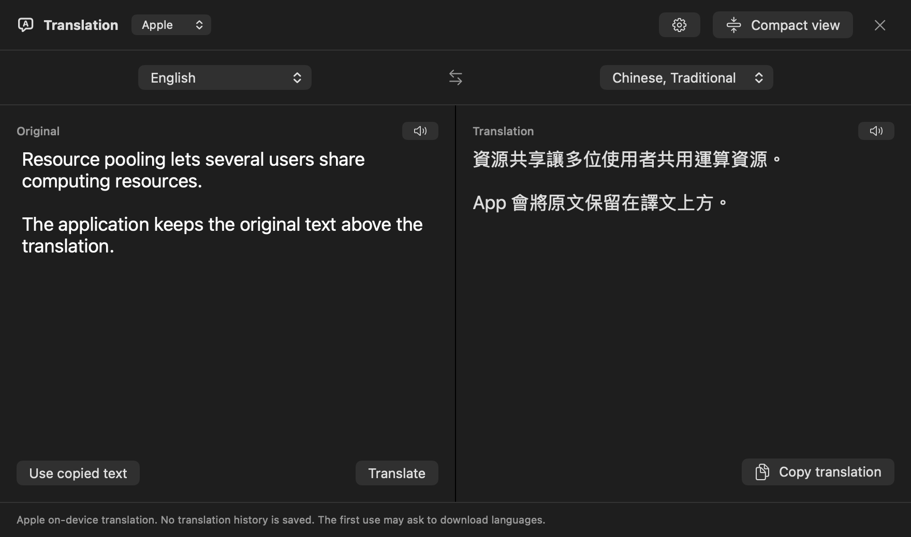
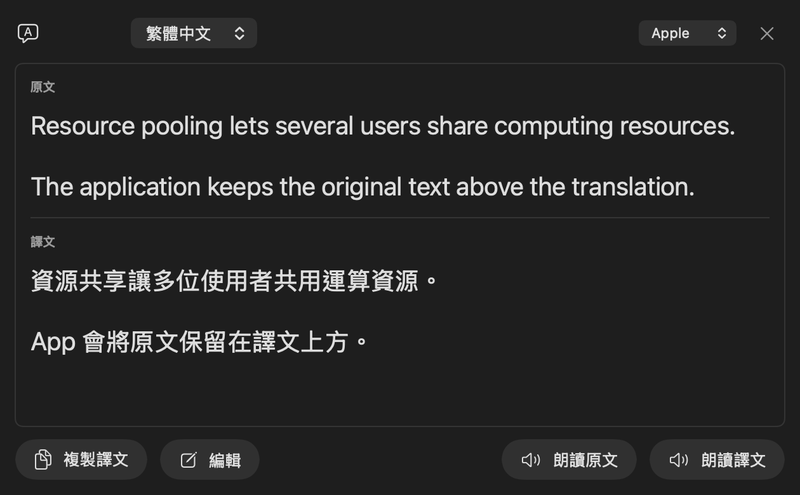

# PlainTranslate

A small, native macOS translator with an editable side-by-side window and a
compact translation popup. Use Apple's on-device translation or connect your
own Google Cloud Translation API key.

**macOS 15 or later · SwiftUI and AppKit · GPL-3.0-or-later**

PlainTranslate is a separate application. It does not modify, replace, update,
or import settings or credentials from Vorssaint. Its translation code and
regression fixtures were adapted with attribution; see [NOTICE.md](NOTICE.md).
The application code is open source. Apple and Google translation engines and
models are provided by their respective platforms/services.

## Interface

Native editor and compact popup, shown with non-sensitive sample text:





## First version

- Apple on-device translation by default; no API key needed for the Apple engine.
- Optional Google Cloud Translation Basic v2 using **each user's own API key**.
- English, Traditional Chinese and Japanese; automatic source detection in the
  editor. Default translation: English → Traditional Chinese.
- Editable original text and translation in a side-by-side window, translating
  automatically after a 0.6-second pause in typing or pasting.
- Language tabs show the three most recent choices, remembered separately for
  source and target. The arrow menu keeps all supported choices available.
  Selecting a visible tab moves the underline without reordering the buttons;
  their positions are preserved between launches.
- Compact popup in one frame, with original above translation and a thin
  separator between them. Each section has read-aloud at the bottom left and
  copy at the bottom right, with adjustable width and text size and outside-click
  dismissal.
- Optional double **⌘C** within 0.7 seconds to translate selected copied text.
  Off by default so it does not compete with Vorssaint or another translator.
- Optional custom shortcut (default **⌃⌥T**): record your own combination in
  settings to copy and translate selected text in another app.
- Optional PDF line-break cleanup that preserves blank paragraphs, lists,
  indentation and table-like spacing. This is text cleanup, not PDF file import.
- Native read-aloud with English, Cantonese, Mandarin and Japanese voice
  preferences and adjustable speech rate.
- Local monthly Google submission estimate and a 90% reference-allowance reminder.
- English and Chinese interface text with native light/dark appearance.

No account, app server, translation history, telemetry or shared developer key.
Read [PRIVACY.md](PRIVACY.md) for engine-specific data handling and permissions.

## Build and run

You need a Mac with macOS 15+, Xcode 16+ (including the macOS 15 SDK), and the
selected Xcode command-line tools. There are no third-party package dependencies.

The build script compiles and links with the selected Xcode's macOS SDK. Use
Xcode 26 or later for the modern native controls on macOS 26 or later; the app's
minimum system requirement remains macOS 15.

```sh
git clone https://github.com/ChyoChan/PlainTranslate.git
cd PlainTranslate
./build.sh --test
./build.sh
open build/PlainTranslate.app
```

`build.sh` builds for the host Mac's architecture, packages the app and applies
an **ad-hoc local signature**. It does not notarize the app or create a signing
certificate or Keychain. Downloaded preview builds may therefore be blocked by
Gatekeeper. A local signature is not a Developer ID signature or Apple
notarization; normal public-distribution signing is a separate release step.

To install the built app in `/Applications`, quit an existing PlainTranslate
instance, then run:

```sh
./build.sh --install
open /Applications/PlainTranslate.app
```

The install option only targets `/Applications/PlainTranslate.app` and refuses
to replace an app with a different bundle identity or a symbolic link. It does
not touch Vorssaint. Settings and saved keys remain when replacing PlainTranslate.

Developers with their own signing identity can set
`PLAINTRANSLATE_SIGNING_IDENTITY` for a local build. The script does not submit
that build to Apple's notarization service.

## Use Apple translation

1. Open PlainTranslate from its menu-bar icon.
2. Keep the engine set to **Apple**.
3. Choose the languages, then type or paste text. Translation starts automatically
   after a 0.6-second pause; input-method composition waits until committed.
4. Allow macOS to download required language models if prompted.

Downloaded models are shared by Apple's Translation framework. Language
availability depends on macOS; the app shows an error instead of silently
sending text to Google if local translation cannot run.

## Connect your Google Cloud key

1. In your own Google Cloud project, enable **Cloud Translation API** and set up
   billing if Google requires it for that project.
2. Create an API key, restrict its API access to **Cloud Translation API**, and
   review the project's quotas and billing alerts.
3. In PlainTranslate settings, select **Google Cloud Translation** and save the
   key. The key is stored in your local macOS Keychain.
4. Choose **Google** in the editor or popup. Editing text automatically translates
   after a 0.6-second pause; choosing an engine in the translation window also
   translates existing text. Each submitted Google request may incur charges.

Google requests are sent directly to the official API and are billed to your
project under Google's current terms. PlainTranslate provides no shared quota.
Do not commit API keys or service-account files to this repository. Basic v2
does not require importing a service-account JSON file into this app.

The local usage estimate counts submitted source Unicode code points and
attempts, including failures after submission. It **does not equal Google Cloud
billing** and does not include other apps or devices. Monthly rollover uses
Hong Kong time. The 90% reminder uses 450,000 of a 500,000-character reference
allowance; it is not a hard quota or a charge-prevention mechanism.

Official setup references:
[Cloud Translation authentication](https://docs.cloud.google.com/translate/docs/authentication),
[API key practices](https://docs.cloud.google.com/docs/authentication/api-keys-best-practices),
[pricing](https://cloud.google.com/translate/pricing).

## Enable quick translation

Enable **Translate on double ⌘C** in settings, then grant Accessibility permission
to PlainTranslate if requested. Select text in another app and copy it twice in
0.7 seconds. The popup can switch to the full editor without losing the text.

If another translator also uses double ⌘C, enable that shortcut in only one app
to avoid two popups. PlainTranslate does not change the other app's settings.
Manual typing/pasting works without Accessibility permission. Selecting Google
means a triggered translation sends the selected text to Google.

Alternatively, enable **Custom translation shortcut** in settings. Click the
shortcut button and press a key with Command, Control or Option; Escape cancels
recording. The default is **Control–Option–T**. Select text in another app and
press your shortcut. PlainTranslate sends that app a Copy command, then translates
only freshly copied, unprotected text with the currently selected engine.
Accessibility permission is required. If another app already uses the combination,
settings shows a conflict so you can choose a different one. Both shortcut options
are off by default and can be enabled independently.

## Tests

```sh
swift test
```

Tests cover double-copy timing/freshness, cancellation identities, compact
dismissal and layout bounds, PDF cleanup, speech language preferences, API-key
validation, complete-selection Google requests, sanitized errors, failed and
cancelled submission accounting, concurrent local counters, and Hong Kong
month boundaries. Google tests use fake transports and dummy keys. Preference
tests use isolated temporary defaults domains. No paid API request, actual
Keychain access, voice download, or audible speech is needed.

GitHub Actions builds and tests on macOS. Its downloadable artifact preserves
the app's executable permissions; it is an unnotarized development artifact.
Actual Apple translation and system permission dialogs require manual testing
on a Mac with the needed language models installed.

## Project layout

```text
Sources/PlainTranslate/   Native app, translation services, settings and UI
Tests/PlainTranslateTests/  Isolated XCTest regressions
Resources/               App bundle metadata
Tools/                   Original icon generation
build.sh                 Independent build and optional installation
```

The project builds from this repository alone and has no dependency on a local
Vorssaint checkout. Do not include actual copied text, credentials, screenshots
of sensitive content, or personal preference files in bug reports or patches.

## 繁體中文快速開始

PlainTranslate 是獨立的 Mac 翻譯 App，不會修改 Vorssaint。

1. 依照上方指令建置，開啟 `build/PlainTranslate.app`。
2. 預設使用 Apple 本機翻譯；首次使用某些語言時，按系統提示下載語言模型。
3. 如需 Google 翻譯，在設定選擇 Google，儲存你自己的 Cloud Translation API key。
4. 在編輯視窗輸入或貼上文字，停止輸入約 0.6 秒後自動翻譯；可用「精簡視窗」顯示原文與譯文彈窗。
5. 雙按 ⌘C 預設關閉；如需使用，在設定啟用並授予「輔助使用」權限。
6. Google 用量僅為這個 App 的本機估算，實際額度及費用請查看自己的 GCP 專案。

目前安裝包採用本機簽署，尚未經 Apple 公證。Apple／Google 的翻譯模型本身不包含在開源範圍內。

## Brand assets

The P/T mark combines the app's initials using a transparent T inside a P. The
complete [logo kit and usage guide](Brand/README.md) includes original outlined
SVG artwork, black/white variants, app icons and web icons under GPL-3.0-or-later.

## License

[GNU General Public License v3.0 or later](LICENSE). Retain the attribution and
license notices when redistributing or modifying this application. Published
binaries must be accompanied by access to their corresponding source under
the GPL. See [NOTICE.md](NOTICE.md) for upstream attribution and original artwork.
