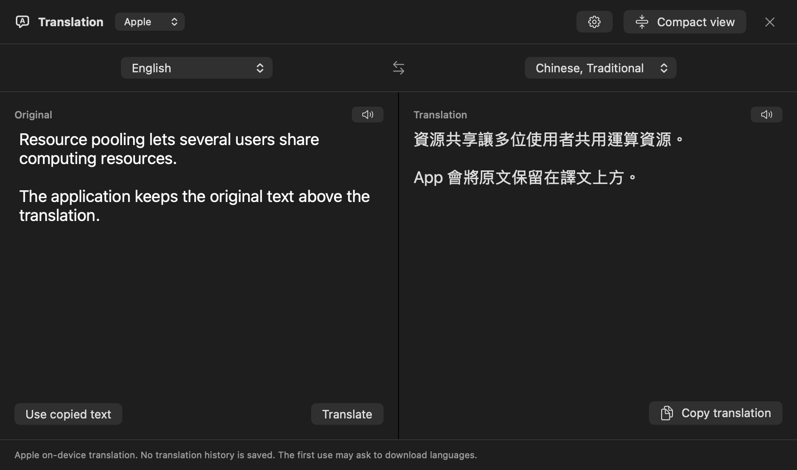
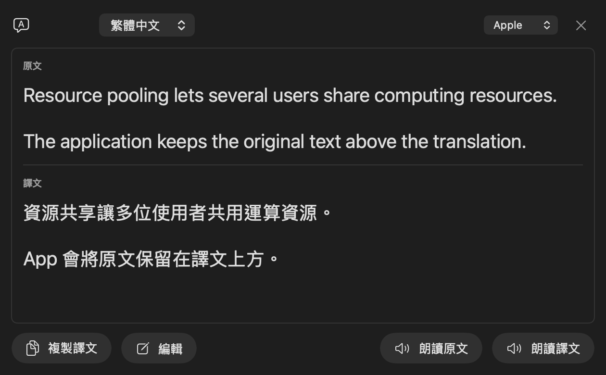

<p align="center">
  <picture>
    <source media="(prefers-color-scheme: dark)" srcset="docs/assets/readme/logo-dark.svg">
    
  </picture>
</p>

<h1 align="center">PlainTranslate</h1>

<p align="center">
  A native translator for your Mac.<br>
  Apple on-device translation or your own Google Cloud key.
</p>

<p align="center">
  <a href="#install">Install</a> ·
  <a href="#everything-it-does">Features</a> ·
  <a href="#get-started">Setup</a> ·
  <a href="#private-by-default">Privacy</a> ·
  <a href="#build-it-yourself">Build</a> ·
  <a href="https://github.com/ChyoChan/PlainTranslate/issues">Issues</a>
</p>

<p align="center">
  <strong>English</strong> ·
  <a href="#繁體中文快速開始">繁體中文</a> ·
  <a href="README.zh-CN.md">简体中文</a> ·
  <a href="README.ja.md">日本語</a>
</p>

<p align="center">
  <a href="https://github.com/ChyoChan/PlainTranslate/releases"></a>
  <a href="https://github.com/ChyoChan/PlainTranslate/releases"></a>
  <a href="https://github.com/ChyoChan/PlainTranslate/actions/workflows/ci.yml"></a>
  <a href="#what-you-need"></a>
  <a href="LICENSE"></a>
</p>

<p align="center">
  
  
</p>

Type, paste or select text in another app. Read the translation in a side-by-side editor or a compact popup, listen to either language, and copy the result. PlainTranslate is free and open source, with no app account, telemetry or shared API key. Optional Google Cloud requests are billed to your own project.

**Preview status:** this README describes the development version. Published previews may contain fewer features; check the [release notes](https://github.com/ChyoChan/PlainTranslate/releases) for the version you download.

## Choose how you translate

| Engine | What you need | Where translation happens |
| --- | --- | --- |
| **Apple** — the default | Download the required language packs when prompted. No API key. | On your Mac, using Apple's Translation framework. |
| **Google Cloud** — optional | Your own Cloud Translation API key, enabled API and billing. | Text goes directly to Google Cloud Translation Basic v2. Usage may incur charges. |

Choose an engine in the translation window or in **Settings → Translation**. PlainTranslate keeps that choice and does not silently switch to Google when Apple translation is unavailable.

## Everything it does

### Translate and edit

- **Two views.** Edit the original and translation side by side, or use a compact popup with the original above the result.
- **Automatic translation.** Pause typing or pasting for 0.6 seconds to translate. Cancel work in progress, then use Translate to start again without editing the text.
- **Four languages.** English, Traditional Chinese, Simplified Chinese and Japanese, with automatic source detection. The default pair is English → Traditional Chinese.
- **Remembered language tabs.** Up to four choices on each side, including automatic detection on the source side. Selecting a tab moves the underline without rearranging the buttons.
- **PDF line-break cleanup.** Join wrapped lines in copied text while preserving paragraphs, lists and indentation. This works on pasted text; it is not PDF file import.
- **Recovery actions.** Temporary failures offer manual retry. Key and language problems show setup guidance. Retrying Google requests can add usage; there is no automatic retry.

### Translate selected text

- **Double ⌘C.** Select text in another app and copy it twice within 0.7 seconds to open the popup.
- **Your own shortcut.** Record a combination in Settings → Shortcuts. The default custom combination is **Control–Option–T**.
- **Adjustable popup.** Change its width and text size, or expand into the editor without losing the original text.
- **Pin the popup.** Keep it open while working in another app. An unpinned popup closes when you click outside. Use × to close it; Esc works when the translation window has keyboard focus.

Both selected-text shortcuts are off by default and require Accessibility permission. Enable double ⌘C in only one translator to avoid opening two popups. Typing and pasting work without that permission.

### Read, copy and manage usage

- **Read aloud.** Listen to the original or translation with installed macOS voices. Choose English, Cantonese, Mandarin or Japanese voices and adjust the speech rate.
- **Copy controls.** Read-aloud sits at the bottom left of each text section; copy sits at the bottom right.
- **In-memory cache.** Repeated text can reuse a successful translation without another engine request or additional Google usage.
- **Google usage estimate.** See this app's recorded monthly submissions and receive a reminder at 90% of the reference allowance.
- **Native settings.** Translation, shortcuts, popup appearance, read-aloud, usage/cache and about/updates, with English, Traditional Chinese, Simplified Chinese and Japanese interface text. The first launch follows your system language; change it in Settings → Translation → Interface language.
- **Release checks.** Manually check GitHub for updates, including previews. Download and installation remain manual.

## Install

Download an app archive and its **SHA256SUMS** from the [releases page](https://github.com/ChyoChan/PlainTranslate/releases). Public previews currently provide ZIP files; the locally prepared DMG has not yet been published there.

1. Quit any running copy of PlainTranslate.
2. Extract the ZIP and move **PlainTranslate.app** into **Applications**. If you have a DMG, open it and drag the app onto its Applications shortcut, then eject the disk image.
3. Open PlainTranslate from Applications or the Dock.
4. Choose an engine and follow the [setup steps](#get-started).

To verify a download, put the archive and its matching `SHA256SUMS` in the same folder and run:

```sh
shasum -a 256 -c SHA256SUMS
```

**Current previews are not Apple-notarized.** They use a local development certificate or ad-hoc signing, rather than an Apple Developer ID distribution signature. If Gatekeeper blocks a trusted copy, attempt to open it, then go to **System Settings → Privacy & Security → Open Anyway**, if offered. See [Apple's instructions](https://support.apple.com/en-us/102445). Packaging the app as a DMG does not remove this requirement.

## Uninstall

Quit PlainTranslate and move it from Applications to the Trash.

Settings and saved credentials are not automatically deleted. To remove the saved Google key, choose **Settings → Translation → Google → Remove key** before uninstalling. Revoke the key in Google Cloud separately if you no longer need it.

## Private by default

PlainTranslate has no account system, advertising, analytics or translation history. No PlainTranslate server receives your text.

- **Apple stays on-device.** Language-pack downloads use Apple's system interface. Models and services are supplied by Apple, rather than included in this repository.
- **Google is your choice.** With Google selected, typing, pasting or invoking translation sends the prepared text directly to Google. Switching to Google in the translation window also translates the existing text. The key stays in your local macOS Keychain.
- **Clipboard access follows your action.** Shortcuts and Translate copied text reject recognized private clipboard markers and changes during the read. Pasting directly into the editor does not preserve these markers; with Google selected, pasted text is automatically submitted for translation. Review sensitive text before using Google.
- **The cache stays in memory.** Up to 20 successful results within a 500 KB UTF-8 budget. Clear it in Settings → Usage & Cache. Quitting, locking the session, or saving/removing the Google key also clears it; closing the popup alone does not.
- **Version checks are manual.** Checking for updates contacts GitHub without translation text or API keys. Setup links open official Google pages in your browser.

Read the [privacy notes](PRIVACY.md) for permissions, network requests, stored settings and usage accounting.

## What you need

- An Apple Silicon Mac for the supplied preview builds
- macOS 15 or later
- An internet connection for initial Apple language downloads, Google translation and update checks
- Your own Google Cloud project and API key only if you choose Google

Builds use the host Mac's architecture. Intel downloads and Universal binaries are not currently provided.

## Get started

### Apple language packs

1. Open **Settings → Translation** and choose **Apple**.
2. Expand **Apple language packs**, then select explicit source and target languages.
3. Check the status and choose **Download language packs…** if needed. Confirm the macOS download prompt.
4. Return to the editor and type or paste text. First-use translation can also request language downloads.

Downloads may continue in the background. If automatic detection cannot identify a short word, select the source language explicitly and try again. Local translation does not fall back to Google.

### Your Google API key

Open **Settings → Translation**, select **Google**, and expand **Create a Google API key — step by step**. The guide links to each official setup page:

1. **Create or select a project.** Use that same project throughout setup.
2. **Enable billing.** Link a billing account and review your budget and quotas.
3. **Enable Cloud Translation API.** PlainTranslate uses **Basic (v2)**.
4. **Create and restrict an API key.** Restrict its API access to Cloud Translation API.
5. **Save the key in PlainTranslate.** Paste it into the key field and choose Save key. To replace an existing key, remove it first. The first Google translation checks whether the key works.

Project creation, billing and key creation happen on Google's website. The app does not supply a shared key or require a service-account JSON file. Google's [setup instructions](https://docs.cloud.google.com/translate/docs/setup), [key practices](https://docs.cloud.google.com/docs/authentication/api-keys-best-practices) and [pricing](https://cloud.google.com/translate/pricing) explain the service requirements.

The monthly usage display is a **local estimate**, not a Google Cloud billing meter. It counts submitted Unicode code points, including spaces, line breaks, and requests that fail or are cancelled after submission. It excludes other apps and devices. Months reset in Hong Kong time. The reminder uses 450,000 of a 500,000-character reference allowance; it does not stop requests or prevent charges. Check actual usage and current allowances in your own Google Cloud project.

## Build it yourself

Install **Xcode 16 or later**, with the macOS 15 SDK or newer and its command-line tools selected. There are no third-party package dependencies. Xcode 26 or later enables modern native controls when running on macOS 26 or later; the minimum supported OS remains macOS 15.

```sh
git clone https://github.com/ChyoChan/PlainTranslate.git
cd PlainTranslate
./build.sh --test
./build.sh
open build/PlainTranslate.app
```

To install a local build, quit the running app first:

```sh
./build.sh --install
open /Applications/PlainTranslate.app
```

<details>
<summary>Keep Accessibility permission across local rebuilds</summary>

Without a configured identity, `build.sh` uses ad-hoc signing. Changed builds can require a fresh Accessibility grant. Create or reuse a dedicated local signing identity once:

```sh
./Tools/SetupLocalSigning.sh
./build.sh
```

Setup keeps a self-signed **PlainTranslate Local Development** identity in your existing user Keychain. The ignored `.local-signing-identity` file contains only its public certificate fingerprint. Subsequent builds reuse it and fail if signing is unavailable, rather than falling back to ad-hoc signing.

Switching from an ad-hoc build, or replacing the certificate, requires a new Accessibility grant. Keep the same certificate and bundle identity for later updates. Setup does not grant permissions or change system trust settings. Local signing is not Developer ID signing or Apple notarization.

An existing signing identity can also be selected with `PLAINTRANSLATE_SIGNING_IDENTITY`. The build script does not submit apps for notarization. CI uses ad-hoc signing and never receives your local signing key.

</details>

### Tests

```sh
./build.sh --test
```

Tests cover translation requests, cancellation, recovery actions, language choices, popup behavior, setup guides, speech preferences, usage estimates and cache boundaries. Google tests use fake transports and dummy keys. Keychain tests use temporary keychains; clipboard tests use separate named pasteboards. UI fixtures use non-sensitive sample text.

Tests do not make paid Google requests or download language packs. Actual Apple translation, download consent, permissions and fresh-machine installation need manual checks. GitHub Actions runs the tests and builds a standalone app; its artifact is not notarized.

## When something misbehaves

| Problem | What to check |
| --- | --- |
| macOS blocks the download | Follow the [installation notes](#install). Current previews are not notarized. |
| A selected-text shortcut does nothing | Enable it in Settings → Shortcuts, then allow **PlainTranslate** under **Privacy & Security → Accessibility**. Restart the app after granting access if needed. |
| Apple needs language packs | Use Settings → Translation → Apple language packs, or follow the first-use system prompt. |
| A short word cannot be detected | Select the source language explicitly. Names and words shared by languages can be ambiguous. |
| Google rejects the key or request | Check the project, enabled API, key restrictions, billing and quotas in Google Cloud. |
| Saving reports an existing key | Use Remove key before saving a replacement. Failed saves preserve the existing item. |
| Esc does not close an unfocused popup | Click ×, or click outside an unpinned popup. Esc applies when the translation window has keyboard focus. |

For a bug report, include your macOS version, app version, selected engine and steps to reproduce. Use non-sensitive sample text; leave out API keys and personal clipboard content.

## Documentation

- [Privacy](PRIVACY.md), what stays on your Mac and what each engine sends
- [Attribution and external services](NOTICE.md), code origins and platform licensing
- [Artwork](Resources/Brand/README.md), app icons and editable SVG masters
- [Tests](Tests/PlainTranslateTests), regression fixtures
- [Build workflow](.github/workflows/ci.yml), automated checks and app packaging

## 繁體中文快速開始

1. 從 [Releases](https://github.com/ChyoChan/PlainTranslate/releases) 下載預覽版，解壓 ZIP 並將 App 移至 Applications；使用 DMG 時，將 App 拖到 Applications 後退出映像檔。
2. 目前預覽版尚未經 Apple 公證。如被攔截，核對來源後到「系統設定 → 隱私權與安全性 → 仍要打開」。
3. 在「設定 → 翻譯」選 Apple，展開「Apple 語言包」下載所需語言；或選 Google，依五步指南建立並儲存你自己的 API Key。
4. 在編輯視窗輸入或貼上文字，停止輸入約 0.6 秒後自動翻譯。取消後可按「翻譯」重新開始。
5. 如需翻譯其他 App 的選取文字，在「設定 → 快捷鍵」啟用雙按 ⌘C 或自訂快捷鍵，並授予 PlainTranslate「輔助使用」權限。
6. 可在「設定 → 翻譯 → 介面語言」切換英文、繁體中文、簡體中文或日文；翻譯語言也支援這四種語言。
7. Google 可能收費；本機用量提醒不等於 GCP 帳單，也不會阻止收費。公開預覽版的功能以各版本發佈說明為準。

## Community

[Bug reports](https://github.com/ChyoChan/PlainTranslate/issues), feature ideas, translations and pull requests are welcome. Keep changes focused and run `./build.sh --test` before submitting code. A GitHub star helps other people find the app.

## License

[GNU GPL 3.0 or later](LICENSE), copyright 2026 PlainTranslate contributors and the authors identified in [NOTICE.md](NOTICE.md). Retain the copyright and license notices, and provide corresponding source when distributing modified binaries. Apple and Google translation models and services are external to the open-source application.

<p align="center">
  <sub>Made by <a href="https://github.com/ChyoChan">ChyoChan</a></sub>
</p>
