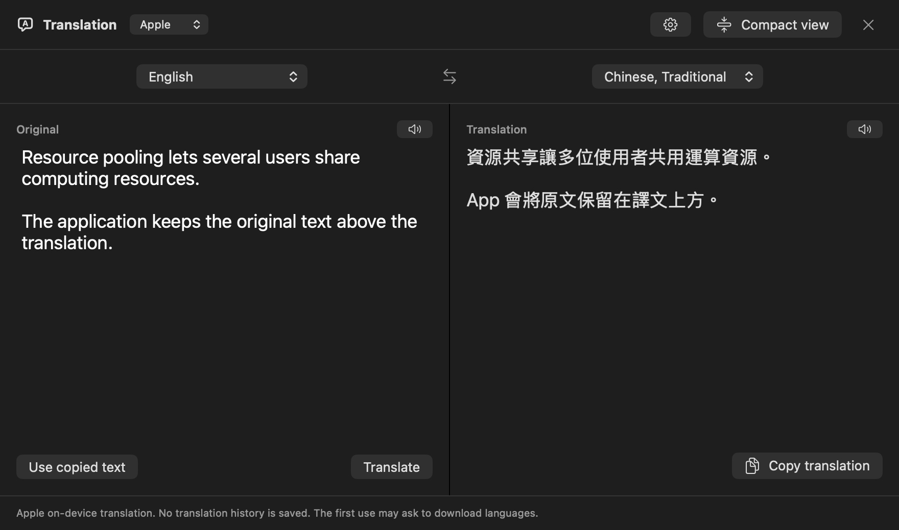
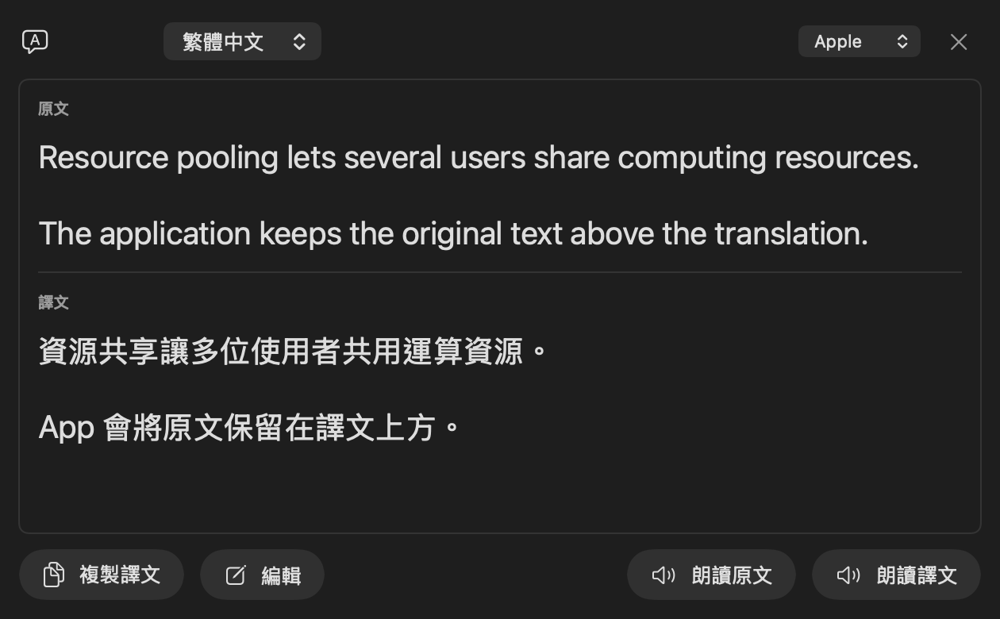

<p align="center">
  <picture>
    <source media="(prefers-color-scheme: dark)" srcset="docs/assets/readme/logo-dark.svg">
    
  </picture>
</p>

<h1 align="center">PlainTranslate</h1>

<p align="center">
  为 Mac 打造的原生翻译 App。<br>
  使用 Apple 本地翻译，或你自己的 Google Cloud 密钥。
</p>

<p align="center">
  <a href="README.md">English</a> ·
  <a href="README.md#繁體中文快速開始">繁體中文</a> ·
  <strong>简体中文</strong> ·
  <a href="README.ja.md">日本語</a>
</p>

<p align="center">
  <a href="#安装">安装</a> ·
  <a href="#功能">功能</a> ·
  <a href="#开始使用">设置指南</a> ·
  <a href="#默认保护隐私">隐私</a> ·
  <a href="#自行构建">构建</a> ·
  <a href="https://github.com/ChyoChan/PlainTranslate/issues">问题反馈</a>
</p>

<p align="center">
  <a href="https://github.com/ChyoChan/PlainTranslate/releases"></a>
  <a href="https://github.com/ChyoChan/PlainTranslate/releases"></a>
  <a href="https://github.com/ChyoChan/PlainTranslate/actions/workflows/ci.yml"></a>
  <a href="#运行要求"></a>
  <a href="LICENSE"></a>
</p>

<p align="center">
  
  
</p>

输入、粘贴，或选取其他 App 中的文字。在并排编辑视窗或精简弹窗中查看翻译、朗读原文和译文，并复制结果。PlainTranslate 免费且开源，无需注册 App 账号，没有遥测，也不提供共享 API 密钥。可选的 Google Cloud 请求由你自己的项目计费。

**预览版说明：**本 README 描述开发版本。已发布的预览版可能尚未包含全部功能，请查看所下载版本的[发布说明](https://github.com/ChyoChan/PlainTranslate/releases)。

## 选择翻译引擎

| 引擎 | 需要准备 | 翻译在哪里进行 |
| --- | --- | --- |
| **Apple**，默认引擎 | 按提示下载所需语言包，无需 API 密钥。 | 在你的 Mac 上，通过 Apple Translation 框架进行。 |
| **Google Cloud**，可选引擎 | 你自己的 Cloud Translation API 密钥，已启用 API 和结算。 | 文字直接发送至 Google Cloud Translation Basic v2，可能产生费用。 |

可在翻译视窗或「设置 → 翻译」中选择引擎。App 会记住你的选择；Apple 翻译不可用时，不会自行切换至 Google。

## 功能

### 翻译与编辑

- **两种视图。** 并排编辑原文和译文，或使用原文在上、译文在下的精简弹窗。
- **自动翻译。** 输入或粘贴后暂停约 0.6 秒即开始翻译。可取消正在进行的翻译，再按「翻译」重新开始，无需修改文字。
- **四种语言。** 英语、繁体中文、简体中文和日语，支持自动识别原文语言。默认方向为英语 → 繁体中文。
- **记住常用语言。** 原文和译文各显示最多四个最近使用的选项，原文可选择自动识别。点击选项时底线移动，按钮次序保持不变。
- **PDF 换行整理。** 整理复制文字中的句内断行，同时保留段落、列表和缩进。此功能处理粘贴的文字，不导入 PDF 文件。
- **错误恢复。** 临时故障提供手动重试；密钥及语言问题提供设置指引。重试 Google 请求可能增加用量，App 不会自动重试。

### 翻译选取的文字

- **双按 ⌘C。** 在其他 App 中选取文字，于 0.7 秒内复制两次，即打开翻译弹窗。
- **自定义快捷键。** 在「设置 → 快捷键」中录制组合，默认自定义组合为 **Control–Option–T**。
- **调整弹窗。** 更改宽度及字体大小，或展开至编辑视窗，原文不会丢失。
- **固定弹窗。** 切换至其他 App 时保持打开。未固定的弹窗会在点击外部时关闭；可按 × 关闭，视窗拥有键盘焦点时也可按 Esc。

两种选取文字快捷键默认关闭，并需要辅助功能权限。请只在一个翻译 App 中启用双按 ⌘C，以免同时打开多个弹窗。输入及粘贴文字不需要此权限。

### 朗读、复制与用量管理

- **朗读。** 使用已安装的 macOS 语音朗读原文或译文，可选择英语、广东话、普通话或日语音色，并调整语速。
- **复制按钮。** 每个文字区域的左下角为朗读，右下角为复制。
- **内存缓存。** 相同文字可复用成功的翻译结果，无需再次请求引擎，也不增加 Google 用量。
- **Google 用量估算。** 查看此 App 记录的每月提交量，并在达到参考额度的 90% 时收到提醒。
- **原生设置。** 包含翻译、快捷键、弹窗外观、朗读、用量与缓存、关于与更新。界面支持英语、繁体中文、简体中文及日语；首次启动会匹配系统偏好语言，也可在「设置 → 翻译 → 界面语言」中更改。
- **检查版本。** 手动检查 GitHub 更新，包含预览版；下载及安装仍由用户手动完成。

## 安装

从[发布页面](https://github.com/ChyoChan/PlainTranslate/releases)下载 ZIP 或 DMG，以及 **SHA256SUMS**。两种安装包包含相同的 App。

1. 退出所有正在运行的 PlainTranslate。
2. 解压 ZIP，将 **PlainTranslate.app** 移到「应用程序」。如使用 DMG，打开后将 App 拖到 Applications 快捷方式，再推出磁盘映像。
3. 从「应用程序」或程序坞打开 PlainTranslate。
4. 选择引擎，按[设置步骤](#开始使用)操作。

如需校验两个安装包，将 ZIP、DMG 和 `SHA256SUMS` 放在同一文件夹，执行：

```sh
shasum -a 256 -c SHA256SUMS
```

**当前预览版未经 Apple 公证。** 它们使用本地开发证书或临时签名，并非 Apple Developer ID 分发签名。如 Gatekeeper 拦截了你信任的文件，请先尝试打开，再到「系统设置 → 隐私与安全性 → 仍要打开」（如有此选项）。参阅 [Apple 说明](https://support.apple.com/zh-cn/102445)。DMG 包装不会免除此要求。

## 卸载

退出 PlainTranslate，将「应用程序」中的 App 移到废纸篓。

设置和已保存的凭据不会自动删除。若要移除 Google 密钥，请先到「设置 → 翻译 → Google → 移除密钥」。不再使用的密钥还应在 Google Cloud 中单独撤销。

## 默认保护隐私

PlainTranslate 没有账号系统、广告、分析追踪或翻译历史。你的文字不会经过 PlainTranslate 服务器。

- **Apple 翻译留在本机。** 语言包通过 Apple 系统界面下载。模型与服务由 Apple 提供，不包含在本仓库内。
- **Google 由你选择。** 选择 Google 后，输入、粘贴或调用翻译会将整理后的文字直接发给 Google。在翻译视窗中切换至 Google 也会翻译现有文字。密钥保存在本机 macOS 钥匙串。
- **剪贴板读取由操作触发。** 快捷键和「翻译已复制文字」会拒绝带有已知私密标记或读取期间发生变化的内容。直接粘贴到编辑器不会保留这些标记；选择 Google 时，粘贴的文字会自动提交翻译。使用 Google 前请检查敏感文字。
- **缓存只存于内存。** 最多 20 条成功结果，总量不超过 500 KB UTF-8。可在「设置 → 用量与缓存」中清除；退出、锁定会话、保存或移除 Google 密钥也会清除。仅关闭弹窗不会清除。
- **手动检查更新。** 检查版本会连接 GitHub，不附带翻译文字或 API 密钥。设置指南链接会在浏览器中打开 Google 官方页面。

[隐私说明（英文）](PRIVACY.md)列出了权限、网络请求、保存的设置及用量统计细节。

## 运行要求

- 预览版下载需要搭载 Apple 芯片的 Mac
- macOS 15 或更新版本
- 初次下载 Apple 语言包、使用 Google 翻译及检查更新时需要联网
- 仅在选择 Google 时需要你自己的 Google Cloud 项目及 API 密钥

构建使用当前 Mac 的处理器架构，目前不提供 Intel 下载或 Universal 通用二进制文件。

## 开始使用

### Apple 语言包

1. 打开「设置 → 翻译」，选择 **Apple**。
2. 展开「Apple 语言包」，明确选择原文和译文语言。
3. 检查状态，必要时按「下载语言包…」，并确认 macOS 的下载提示。
4. 返回编辑视窗，输入或粘贴文字。首次翻译时也可能出现下载提示。

下载可能在后台继续。自动识别无法判断短词时，请明确选择原文语言再试。本地翻译不会自动改用 Google。

### 你自己的 Google API 密钥

打开「设置 → 翻译」，选择 **Google**，展开「逐步创建 Google API Key」。指南链接到每个步骤对应的官方页面：

1. **创建或选择项目。** 所有步骤都使用同一个项目。
2. **启用结算。** 关联结算账号，检查预算及配额。
3. **启用 Cloud Translation API。** PlainTranslate 使用 **Basic（v2）**。
4. **创建并限制 API 密钥。** 将 API 访问权限限制为 Cloud Translation API。
5. **在 PlainTranslate 保存密钥。** 粘贴至密钥栏，按「保存密钥」。更换时须先移除旧密钥。首次 Google 翻译会检查密钥是否有效。

项目、结算和密钥都在 Google 网站上创建。App 不提供共享密钥，也不需要服务账号 JSON 文件。可参阅 Google 的[设置指南](https://docs.cloud.google.com/translate/docs/setup?hl=zh-cn)、[密钥使用建议](https://docs.cloud.google.com/docs/authentication/api-keys-best-practices?hl=zh-cn)及[定价](https://cloud.google.com/translate/pricing?hl=zh-cn)。

每月用量是**本地估算**，并非 Google Cloud 计费仪表。它统计已提交的 Unicode 码点，包括空格、换行，以及提交后失败或取消的请求；不包含其他 App 或设备。月份按香港时间重置。提醒门槛为参考额度 500,000 字符的 90%，即 450,000 字符；不会停止请求或防止收费。实际用量及现行额度请在自己的 Google Cloud 项目中确认。

## 自行构建

安装 **Xcode 16 或更新版本**及 macOS 15 或更新 SDK，并选中相应命令行工具。没有第三方包依赖。Xcode 26 或更新版本可在 macOS 26 或更新系统上启用现代原生控件，最低系统要求仍是 macOS 15。

```sh
git clone https://github.com/ChyoChan/PlainTranslate.git
cd PlainTranslate
./build.sh --test
./build.sh
open build/PlainTranslate.app
```

安装本地构建前先退出正在运行的 App：

```sh
./build.sh --install
open /Applications/PlainTranslate.app
```

<details>
<summary>在本地重建后保留辅助功能权限</summary>

未配置签名身份时，`build.sh` 使用临时签名；更改后的构建可能需要重新授权。可以一次性创建或复用专用本地签名身份：

```sh
./Tools/SetupLocalSigning.sh
./build.sh
```

设置会在现有用户钥匙串中保留自签名的 **PlainTranslate Local Development** 身份。被 Git 忽略的 `.local-signing-identity` 文件仅保存公开证书指纹。后续构建复用该身份，签名不可用时会失败，不会退回临时签名。

从临时签名切换，或更换证书时，需要重新授权。后续更新请保持相同证书和 Bundle ID。设置脚本不会授予权限或更改系统信任设置；本地签名不等于 Developer ID 签名或 Apple 公证。

也可通过 `PLAINTRANSLATE_SIGNING_IDENTITY` 指定现有身份。构建脚本不会提交公证。CI 使用临时签名，不会取得你的本地私钥。

</details>

### 项目结构

- `Sources/PlainTranslate/App/` — App 入口、偏好设置和界面语言.
- `Sources/PlainTranslate/Translation/` — 翻译状态、模型、引擎和视图.
- `Sources/PlainTranslate/Settings/` — 设置窗口、权限状态和设置指南.
- `Sources/PlainTranslate/Updates/` — 版本检查及对应设置区域.
- `Sources/PlainTranslate/Platform/` — 共用 macOS 集成和受限 HTTP 传输.
- `Tests/PlainTranslateTests/` — 按相同功能分类的回归测试；共用 UI 测试工具位于 `Support`.

### 测试

```sh
./build.sh --test
```

测试涵盖翻译请求、取消、错误恢复、语言选择、弹窗行为、设置指南、语音偏好、用量估算及缓存边界。Google 测试使用模拟传输和假密钥；钥匙串测试使用临时钥匙串；剪贴板测试使用独立命名的剪贴板。界面测试只使用不敏感的示例文字。

测试不会发送付费 Google 请求或下载语言包。真实 Apple 翻译、下载确认、权限及新机器安装仍需手动检查。GitHub Actions 运行测试并构建独立 App，其产物未公证。

## 故障排查

| 问题 | 检查方法 |
| --- | --- |
| macOS 拦截下载的 App | 参阅[安装说明](#安装)。当前预览版未经公证。 |
| 选取文字快捷键没有反应 | 在「设置 → 快捷键」中启用，并在「隐私与安全性 → 辅助功能」中允许 PlainTranslate。授权后必要时重启 App。 |
| Apple 需要语言包 | 使用「设置 → 翻译 → Apple 语言包」，或按首次使用提示操作。 |
| 短词无法识别 | 明确选择原文语言。姓名和多个语言共用的词可能有歧义。 |
| Google 拒绝密钥或请求 | 检查 Google Cloud 中的项目、API、密钥限制、结算和配额。 |
| 保存时提示已有密钥 | 先移除，再保存新密钥。保存失败会保留旧条目。 |
| Esc 无法关闭未聚焦弹窗 | 点击 ×，或点击未固定弹窗外部。Esc 仅在翻译视窗拥有键盘焦点时生效。 |

反馈问题时，请附上 macOS 版本、App 版本、所选引擎及复现步骤。使用不敏感的示例文字，请勿包含 API 密钥或私人剪贴板内容。

## 文档

- [隐私（英文）](PRIVACY.md)：本机保存的内容及各引擎发送的内容
- [署名与外部服务（英文）](NOTICE.md)：代码来源及平台许可
- [图标素材（英文）](Resources/Brand/README.md)：App 图标和可编辑 SVG 原稿
- [测试](Tests/PlainTranslateTests)：回归测试用例
- [构建流程](.github/workflows/ci.yml)：自动检查及 App 打包

## 社区

欢迎[问题反馈](https://github.com/ChyoChan/PlainTranslate/issues)、功能建议、翻译及 Pull Request。请保持改动范围集中，提交代码前运行 `./build.sh --test`。在 GitHub 加星可帮助更多人发现这个 App。

## 许可证

采用 [GNU GPL 3.0 或更新版本](LICENSE)。版权所有 2026 PlainTranslate 贡献者及 [NOTICE.md](NOTICE.md) 中列出的作者。分发修改后的二进制文件时，请保留版权及许可证声明，并提供对应源代码。Apple 与 Google 的翻译模型和服务不属于此开源 App。

<p align="center">
  <sub>由 <a href="https://github.com/ChyoChan">ChyoChan</a> 制作</sub>
</p>
